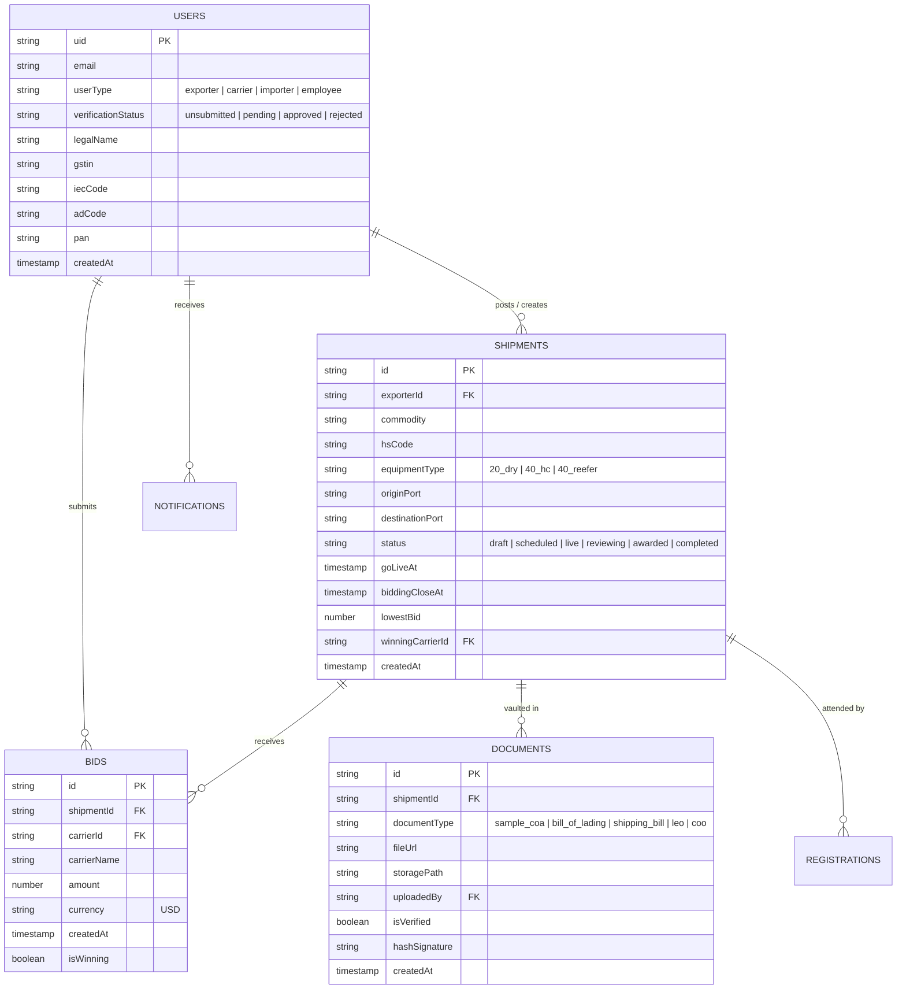

# ShipCargo — System Architecture, Security & Operational Process Documentation

```
Domain:         https://www.shipcargo.in
Target Region:  India (Gateway Ports: JNPT, Mundra, Chennai, Vizag, Cochin) → Global Destinations
Stack:          Next.js 15 (App Router, RSC), TypeScript, Tailwind CSS, Firebase (Firestore, Auth, Storage, Functions), PWA
Lead Advisor:   Mr. Lijo Augustine (+91 8089720725 · advisory@shipcargo.in)
Document Ver:   2.4.0 (November 2026)
```

---

## 1. Executive Overview & Mission

**ShipCargo** is India’s specialized digital cross-border trade and live ocean freight bidding platform. It bridges Indian commodity exporters, international wholesale importers, and certified multi-modal transport operators (MTOs/FMC ocean carriers).

### The Problem It Solves
Traditional cross-border freight and commodity sourcing from India suffers from three systemic inefficiencies:
1. **Unverifiable Commodity Quality & Disputes:** Exporters negotiate over WhatsApp, samples arrive uncertified, and buyers default or reject consignments post-shipment.
2. **Opaque Ocean Freight Pricing:** Freight forwarders add 15% to 35% markups without competition, leading to excessive landed shipping costs.
3. **Fragmented Documentation & Regulatory Delays:** Bills of Lading, ICEGATE Shipping Bills, Bank Realization Certificates (e-BRC), and Certificates of Origin are scattered across emails and physical couriers, stalling customs clearance and working capital.

### The ShipCargo Solution
ShipCargo unifies this entire workflow into a single, tamper-evident pipeline:
* **Public Demand Radar:** Transparent visibility into verified international buyer requirements with HS code specifications.
* **Document Room:** Cryptographic vault where quality COAs, analytical reports, and sample approvals are signed off before cargo dispatch.
* **Live Reverse Freight Auctions:** Once quality is locked, verified MTO/FMC carriers compete in real-time reverse auctions, driving container freight rates down by 15–22%.
* **Regulatory Compliance Desk:** Direct statutory support for DGFT (IEC), CBIC/ICEGATE (LEO), GST (LUT RFD-11 zero-rating), and RBI FEMA realization led by Senior Export Advisor **Mr. Lijo Augustine**.

---

## 2. High-Level System Architecture

ShipCargo uses a hybrid architecture combining server-rendered static web pages (for optimal Google Technical SEO and speed) with real-time reactive islands (for live bidding, telemetry tracking, and PWA offline capabilities).

```mermaid
flowchart TD
    subgraph ClientLayer ["Client & Edge Presentation Layer"]
        PWA["Progressive Web App (PWA) / Desktop & Mobile Shell"]
        SW["Service Worker (sw.js) & Cache Storage"]
        NextRSC["Next.js 15 Server Components (RSC) / Pre-Rendered HTML"]
        LiveIslands["Client Islands (Live Auction HUD, Demand Radar, Telemetry)"]
    end

    subgraph SecurityEdge ["Security & Edge Gateway"]
        SecurityHeaders["HTTP Security Headers (HSTS, CSP, Frame-Options)"]
        RobotsSitemap["Robots Engine & Sitemaps (Vertical Indexing)"]
        PwaPrompt["PWA Install & Offline Fallback Engine (/offline)"]
    end

    subgraph ApplicationCore ["Application & Business Logic Layer"]
        AuthContext["Auth Context & RBAC Manager (Exporter, Importer, Carrier, Admin)"]
        LifecycleSweeper["Shipment Lifecycle Sweeper (Deterministic ms Timers)"]
        DocRoomEngine["Document Room Vault & Cryptographic Verification"]
        ReverseAuctionEngine["Reverse Auction & Soft-Close Sniping Guard"]
    end

    subgraph CloudServices ["Firebase & Cloud Services Layer"]
        FirebaseAuth["Firebase Authentication (Custom Claims & Token Minting)"]
        Firestore["Cloud Firestore (ACID Transactions & Real-time Listeners)"]
        CloudStorage["Cloud Storage (Immutable Trade Documents & Encrypted COAs)"]
        CloudFunctions["Cloud Functions V2 (Event-Driven Triggers & Scheduled Cron)"]
        PaymentGateway["Razorpay Escrow & Statutory Verification Gateway"]
    end

    ClientLayer --> SecurityEdge
    SecurityEdge --> ApplicationCore
    ApplicationCore --> CloudServices
```



### Technology Stack Specifications

| Layer | Technologies Used | Key Purpose |
| :--- | :--- | :--- |
| **Frontend Framework** | Next.js 15.3 (App Router), React 19, TypeScript | Server Components for SEO, Client Islands for interactive real-time widgets |
| **Styling & Design System** | Tailwind CSS 3.4, Shadcn UI primitives, Lucide Icons | Responsive UI following brand colors: Deep Sapphire (`#13285A`), Pearl Shell (`#ECE6DC`), Ember Orange (`#FF5A12`) |
| **Database** | Google Cloud Firestore (Native NoSQL) | Sub-second real-time bid sync, transactional bid decrements, structured document metadata |
| **Authentication** | Firebase Auth (JWT Tokens, Custom Claims) | Multi-role user identity management (Exporter, Importer, Carrier, Compliance Officer) |
| **File Storage** | Firebase Cloud Storage | Encrypted, tamper-evident document storage with signed read tokens |
| **Offline & PWA** | Web Worker (`sw.js`), Web App Manifest, Cache Storage | Full mobile & desktop app installability, offline fallback with emergency phone dialer |
| **Payment Integration** | Razorpay SDK | GST verification fees, escrow retention, and freight transaction deposits |

---

## 3. Data Model & Database Architecture

ShipCargo’s data persistence is organized into relational Firestore collections with strict validation rules and compound indexing.



### Compound Index Configurations (`firestore.indexes.json`)
To enable millisecond sorting and filtering across high-velocity auctions, the following compound indexes are enforced in production:
1. `shipments`: `exporterId` (ASC) + `createdAt` (DESC) — Powers the Exporter Dashboard shipment ledger.
2. `shipments`: `status` (ASC) + `goLiveAt` (ASC) — Powers the deterministic scheduled-to-live lifecycle sweeper.
3. `shipments`: `status` (ASC) + `biddingCloseAt` (ASC) — Drives live countdown timers and auto-close triggers.
4. `bids` (Collection Group): `carrierId` (ASC) + `createdAt` (DESC) — Powers carrier historical bid analytics across all active and awarded auctions.

---

## 4. Security Architecture & Access Control

ShipCargo enforces defense-in-depth across the transport, application, database, and storage layers.

### 1. HTTP Security Headers (`next.config.ts`)
* **Strict-Transport-Security (HSTS):** `max-age=31536000; includeSubDomains; preload` enforces end-to-end TLS encryption.
* **Content-Security-Policy (CSP):** `upgrade-insecure-requests` prevents mixed-content vulnerabilities.
* **Clickjacking Protection:** `X-Frame-Options: SAMEORIGIN` prevents unauthorized framing.
* **MIME Sniffing Prevention:** `X-Content-Type-Options: nosniff`.
* **Service Worker Isolation:** Dedicated `Service-Worker-Allowed: /` and `Cache-Control: no-cache, no-store, must-revalidate` for `sw.js` to guarantee immediate zero-stale lifecycle updates.

### 2. Firestore Role-Based Access Control (`firestore.rules`)
Firestore Security Rules guarantee that no user can tamper with freight bids or trade documents:
* **Approved Carrier Gate:** Only carriers with `verificationStatus == 'approved'` can submit bids to active auctions.
* **Strict Decrement Enforcement:** Every new bid submitted to `shipments/{id}/bids` must be strictly lower than the current `lowestBid`.
* **Soft-Close / Sniping Protection:** If a bid is submitted in the final 2 minutes of an auction, the closure timestamp is extended automatically by 2 minutes, preventing bot sniping.
* **Exporter Isolation:** Exporters can read and edit only shipments where `request.auth.uid == resource.data.exporterId`.
* **Tamper-Evident Document Room:** Document sign-offs and status flags cannot be modified once approved by the opposing party without mutual cryptographically verified authorization.

### 3. Statutory Data Confidentiality & DPDP Act 2023 Compliance
Under the *Digital Personal Data Protection (DPDP) Act 2023*:
* Buyer commercial identities are masked on public indexable pages. The public **Demand Radar** displays anonymized procurement summaries (e.g., *"Rotterdam Buyer · 24 MT Basmati Rice"*).
* Full buyer KYC, shipping invoices, and Letters of Credit are decrypted solely within the secure authenticated Document Room.

---

## 5. End-to-End Operational Process Flow

The ShipCargo trade process executes in five deterministic phases.

```mermaid
sequenceDiagram
    autonumber
    actor Importer as Overseas Importer
    actor Exporter as Indian Exporter
    actor Advisor as Export Advisor (Mr. Lijo)
    actor Carrier as FMC/MTO Carrier
    participant Platform as ShipCargo Platform / Doc Room
    participant Customs as ICEGATE / Customs EDI

    Note over Importer, Exporter: Phase 1: Requisition & KYC Matching
    Importer->>Platform: Post Purchase Requisition (Product, Quantity, Incoterm)
    Exporter->>Platform: Submit KYC (IEC, GSTIN, PAN, Bank AD Code)
    Advisor->>Platform: Verify Export Licenses & Certify Exporter

    Note over Exporter, Platform: Phase 2: Sample Approval & Doc Room Lock
    Exporter->>Importer: Dispatch Sealed Batch Sample via Courier
    Exporter->>Platform: Upload Lab Test COA (Purity, Pesticide Residue)
    Importer->>Platform: Test Sample & Log Digital Approval in Document Room
    Platform->>Platform: Lock Cargo Specs; Unlock Live Reverse Auction

    Note over Exporter, Carrier: Phase 3: Live Reverse Freight Auction
    Exporter->>Platform: Schedule Auction (Equipment, Origin Port, Gateway Date)
    Platform->>Carrier: Broadcast Auction Alert to Verified Carriers
    Carrier->>Platform: Submit Decremental Bids ($1,500 → $1,420 → $1,340)
    Platform->>Platform: Soft-Close Enforced; Bidding Closes
    Exporter->>Carrier: Award Shipment to Winning Carrier

    Note over Exporter, Customs: Phase 4: Documentation & ICEGATE Clearance
    Carrier->>Platform: Upload Draft Ocean Bill of Lading (OBL)
    Exporter->>Customs: File Shipping Bill (RoDTEPY Flag & LUT RFD-11)
    Customs->>Exporter: Issue Let Export Order (LEO) Clearance
    Exporter->>Platform: Vault Final LEO, Invoice & Certificate of Origin

    Note over Carrier, Importer: Phase 5: Container Movement & Settlement
    Carrier->>Platform: Record Terminal Gate-In (JNPT / Mundra)
    Platform->>Importer: Transmit Digital Document Vault
    Importer->>Exporter: Release Payment / Settle UCP 600 Letter of Credit
    Customs->>Exporter: Generate RoDTEP Electronic Duty Scrip in ICEGATE Ledger
```

### Phase-by-Phase Operational Details

#### Phase 1: Registration & Regulatory Onboarding
* **Exporter Verification:** The exporter registers and submits their 10-digit Importer-Exporter Code (IEC), 15-digit GSTIN, Permanent Account Number (PAN), and Authorized Dealer (AD) Code letter issued by their bank.
* **Carrier SLA Execution:** Carriers submit their Multi-Modal Transport Operator (MTO) license or Federal Maritime Commission (FMC) registration, agreeing to standard transit SLAs and demurrage caps.

#### Phase 2: Sourcing, Sample Dispatch & Document Room Approval
* The exporter packages a representative analytical batch (e.g., 500g Basmati Rice or 250g Paracetamol API) and dispatches it under temperature/seal logging.
* Test reports from NABL-accredited laboratories are uploaded to the **Document Room**.
* The overseas buyer tests the sample against destination pharmacopoeia/food safety standards and logs their **digital sign-off**.
* **Crucial Rule:** No shipment can proceed to live freight bidding without an approved sample certificate, eliminating transit cargo disputes.

#### Phase 3: The Live Reverse Freight Auction
* The exporter specifies equipment requirements (e.g., *2x 40' High Cube Dry Containers, JNPT Nhava Sheva to Jebel Ali*).
* The **Shipment Lifecycle Sweeper** transitions the shipment to `status: "live"`.
* Bidding operates as a **reverse auction**:
  * Each bid must decrement below the current lowest figure.
  * Carriers can see their competitor ranking (Rank 1, Rank 2) and the current lowest quote in USD.
  * **Soft-Close Anti-Sniping:** Any bid received within the final 2 minutes resets the remaining auction clock to 2 minutes.
* Upon closure, the exporter awards the contract to the carrier offering the best balance of ocean freight, transit time, and free detention days.

#### Phase 4: Customs Clearance & Document Vaulting
* The carrier generates the booking confirmation and draft Ocean Bill of Lading (BL).
* The exporter files their export documents via ICEGATE:
  * Zero-rated supply under **GST LUT Form RFD-11** (no IGST deposited).
  * Mandatory **RoDTEPY** or **ROSCTLY** declaration code flagged on the shipping bill.
* Customs performs cargo appraisal and issues the **Let Export Order (LEO)**.
* All four mandatory trade documents (Commercial Invoice, Packing List, Bill of Lading, and LEO) are sealed into the ShipCargo Document Room.

#### Phase 5: Ocean Transit, Telemetry & Realization
* Telemetry tracks container gate-in at the gateway terminal and vessel departure.
* The carrier issues the final original Bill of Lading (or Sea Waybill).
* The exporter submits the shipping bill number and electronic invoice to their Authorized Dealer bank for tracking in the **RBI EDPMS (Export Data Processing and Monitoring System)**.
* Once foreign exchange proceeds are realized (within the 9-month FEMA window), the bank generates an electronic Bank Realization Certificate (**e-BRC**), unlocking full RoDTEP electronic duty scrip monetization on ICEGATE.

---

## 6. Progressive Web App (PWA) Architecture

ShipCargo is architected to operate natively across devices without requiring App Store or Google Play downloads:

```
┌────────────────────────────────────────────────────────┐
│                   ShipCargo PWA Engine                 │
├──────────────────────────┬─────────────────────────────┤
│ Web App Manifest         │ manifest.webmanifest        │
│ Theme & Accent Colors    │ Deep Sapphire (#13285A)     │
│ Orientation & Display    │ Standalone, Any Orientation │
│ Service Worker           │ /sw.js (Network-First HTML) │
│ Offline Fallback         │ /offline (Local Tools HUD)  │
│ Desktop Compatibility    │ Windows, macOS, ChromeOS    │
│ Mobile Compatibility     │ Android & iOS Safari        │
└──────────────────────────┴─────────────────────────────┘
```

### Key PWA Capabilities
1. **Desktop & Mobile Install Prompts:** Custom floating banner and header/drawer controls listening to `beforeinstallprompt` and iOS Share Sheet detection.
2. **Offline Mode (`/offline`):** When connectivity is lost at remote ports or CFS facilities, the app serves locally cached tools (Demand Radar, Document Room guidelines, Freight Calculator).
3. **Emergency Voice Hotline:** The offline screen directly integrates cellular voice dialing to **Mr. Lijo Augustine (+91 8089720725)**, enabling telephone escalation even when internet data is severed.

---

## 7. Trade Advisory & Operations Model

ShipCargo couples digital workflow technology with personalized, expert human oversight:

### Dedicated Senior Export Advisor
* **Lead Advisor:** **Mr. Lijo Augustine**
* **Direct Telephone:** [`+91 8089720725`](tel:+918089720725)
* **Direct WhatsApp:** [Chat with Mr. Lijo](https://wa.me/918089720725)
* **Official Advisory Email:** `advisory@shipcargo.in`
* **Operating Hours:** Monday – Saturday, 09:00 AM – 07:00 PM IST

### Advisory Functions
1. **Statutory DGFT Guidance:** Assisting new exporters in securing their IEC and registering with Export Promotion Councils (APEDA, Spices Board, Pharmexcil, EEPC).
2. **Customs ICEGATE Resolution:** Troubleshooting shipping bill queries, tariff classification (HS Code selection), and RoDTEP ledger scrip creation.
3. **Bidding Strategy & Carrier Dispute Mediation:** Advising shippers on reserve prices, equipment availability, and ocean carrier SLA compliance.

---

## 8. Directory & Source Code Reference Index

| File / Component Path | Primary Responsibility |
| :--- | :--- |
| [`src/app/layout.tsx`](file:///Users/pranavghosh/Desktop/AI Products/ShipCargo/src/app/layout.tsx) | Root HTML shell, PWA metadata, Viewport, font loader, and structured data |
| [`src/app/manifest.ts`](file:///Users/pranavghosh/Desktop/AI Products/ShipCargo/src/app/manifest.ts) | Dynamic Next.js PWA Web App Manifest generator |
| [`public/sw.js`](file:///Users/pranavghosh/Desktop/AI Products/ShipCargo/public/sw.js) | Production service worker (Network-First HTML, Cache-First static assets) |
| [`src/app/offline/page.tsx`](file:///Users/pranavghosh/Desktop/AI Products/ShipCargo/src/app/offline/page.tsx) | Dedicated offline fallback view with emergency cellular voice hotline |
| [`src/components/pwa-installer.tsx`](file:///Users/pranavghosh/Desktop/AI Products/ShipCargo/src/components/pwa-installer.tsx) | Cross-platform PWA install prompt banner and iOS Safari guide |
| [`src/app/contact/page.tsx`](file:///Users/pranavghosh/Desktop/AI Products/ShipCargo/src/app/contact/page.tsx) | Canonical Contact Us page featuring Mr. Lijo Augustine |
| [`src/components/contact-inquiry-form.tsx`](file:///Users/pranavghosh/Desktop/AI Products/ShipCargo/src/components/contact-inquiry-form.tsx) | Priority trade inquiry form with 2-hour response SLA |
| [`src/components/ShipmentLifecycleSweeper.tsx`](file:///Users/pranavghosh/Desktop/AI Products/ShipCargo/src/components/ShipmentLifecycleSweeper.tsx) | Deterministic millisecond auction scheduler and status state machine |
| [`src/components/app-providers.tsx`](file:///Users/pranavghosh/Desktop/AI Products/ShipCargo/src/components/app-providers.tsx) | Global 5-column footer, navigation, and theme provider |
| [`firestore.rules`](file:///Users/pranavghosh/Desktop/AI Products/ShipCargo/firestore.rules) | Role-based Firestore security rules and anti-sniping protection |
| [`firestore.indexes.json`](file:///Users/pranavghosh/Desktop/AI Products/ShipCargo/firestore.indexes.json) | Production compound index definitions for shipments and bids |
| [`next.config.ts`](file:///Users/pranavghosh/Desktop/AI Products/ShipCargo/next.config.ts) | HTTP security headers, 301 redirects, and image caching rules |
